# ROS2 Mobile Robotics: TurtleBot Navigation and Odometry Simulation

Four programs I wrote for the TurtleBot3 Burger, two in Python on ROS2 and two in C++. The Python nodes drive the real robot and its Gazebo twin: one traces a 1 m square from odometry alone, the other wanders an arena avoiding pillars with the laser scanner while Cartographer builds a SLAM map. The C++ side is a differential drive odometry simulation that plots two robots' paths and draws a room map, and a ROS2 node that steers the robot from its home corner to a charging station using laser landmarks.

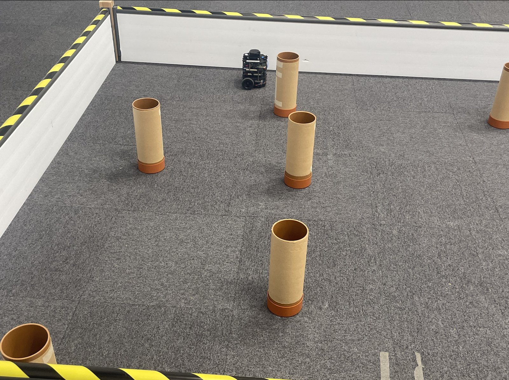

## What it does

- **Square path from odometry.** The robot drives a 1 m square with no external sensors. It reads its own x, y and heading from the wheel encoders, drives each side at 0.2 m/s, turns each corner on the spot at 0.2 rad/s through a full 90 degrees, and logs every reading to a text file so the route can be plotted.
- **Laser scanner navigation.** The robot drives forward and checks the 60 degree cone in front of it. Anything closer than 0.5 m makes it stop and turn on the spot away from the nearer obstacle until the cone is clear. Running it with Cartographer and RViz open builds a map of the arena as it goes.
- **Odometry simulation in C++.** Two differential drive robots start at the same point and heading with different wheel speeds. The program steps their kinematics 100 times and writes both paths to a CSV, which shows one curving right and the other curving left.
- **Environment map in C++.** Writes a point cloud of a 2.5 m square room with four pillars, a charging station and a square robot, ready to plot.
- **Landmark based navigation to the charger.** A ROS2 C++ node that takes the simulated robot from the corner to the charger through the pillars, using laser distances to known landmarks to step through a six stage state machine, while logging the laser beams, the map points, the trajectory and the speed to CSV files.

## My role

All of this is my own work. I wrote every line of the Python and C++, ran the robot in the arena and in Gazebo, collected the odometry and laser logs, and plotted the results in Excel and LibreOffice.

## How it works

### Square path (python/trajectory_tracking.py)

The node subscribes to the odom topic and publishes velocity commands every 0.3 s. It converts the orientation quaternion to a heading in degrees and runs a seven step sequence: forward until x passes 1 m, turn, forward until y passes 1 m, turn, back along x, turn, back along y, stop. Each corner adds up how far the heading has moved since that corner started and finishes at 90 degrees, so every corner is a full quarter turn wherever the heading began. Each step of the heading is wrapped into minus 180 to 180, so crossing from 180 to minus 180 on the third corner still counts as a small turn rather than a jump.

Every tick the x, y and heading are appended to myodom.txt. I logged two runs on the real robot and plotted them against the 1 m target square. Test 1 logged the first two sides and reached the far corner within 4.5 cm of (1, 1). Test 2 logged the full loop and finished 0.30 m from where it started. On the real robot the start heading has to be lined up exactly so the first corner lands where it should, and the run takes longer than in simulation because of the floor. The odometry error grew on every turn, which is the usual encoder drift, and the TurtleBot's Kalman filter fusing the encoders with its IMU is what keeps it as accurate as it is.

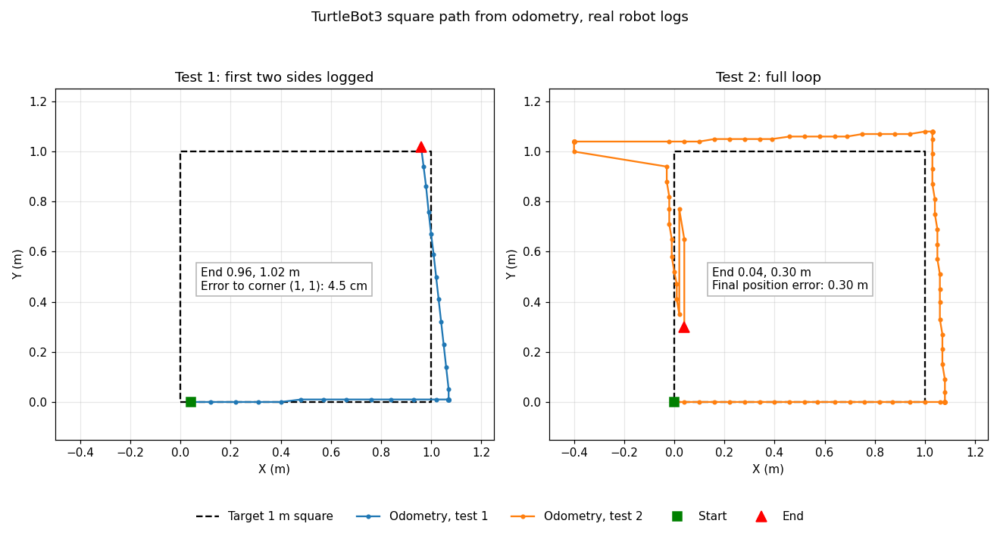

### Laser navigation (python/laser_navigation.py)

The node works out each beam's angle from the scan's own angle_min and angle_increment, so it does not depend on the scanner giving exactly one reading per degree. It takes the nearest usable reading in the 30 degrees either side of straight ahead. A beam with nothing inside the scanner's maximum range counts as clear, so open space never stops the robot. Readings that are NaN or below the minimum range are skipped, which also covers the zero the real sensor reports for a beam that gets no return. If either side is under 0.5 m the robot stops moving forward and turns on the spot at 0.5 rad/s away from the nearer obstacle, right if it is on the left and left if it is on the right, then carries on at 0.2 m/s once the cone is clear. If there is no usable reading anywhere in the cone, the robot stops rather than drive blind, and if no new scan has arrived for one second it publishes zero velocity until scans come back. The laser topic has to be subscribed with best effort reliability or nothing arrives.

I used this with Cartographer and RViz to build SLAM maps of the arena. Driving the robot by hand with the keyboard took about 5 minutes in simulation and over 8 minutes on the real robot, because the real arena is much bigger. Letting the node drive took about 3 minutes in simulation and 6 minutes for real, with no collisions in either. The things I would add next are a particle filter for the pose estimate and a random walk so the robot stops repeating the same loop when there are no obstacles.

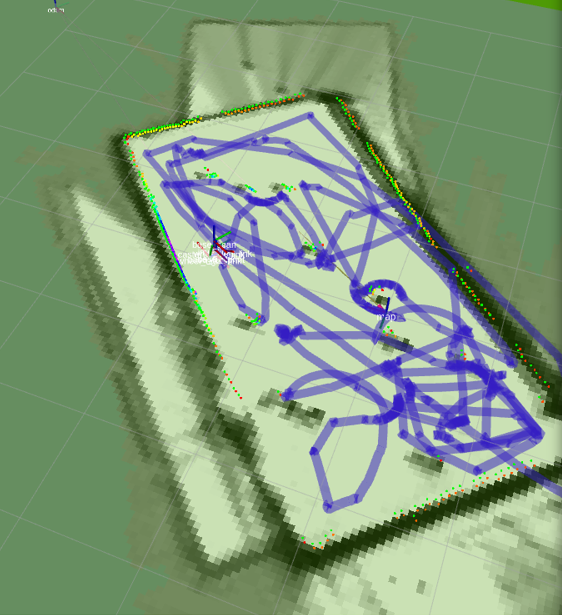

### Odometry simulation (cpp/odometry_sim.cpp)

Both robots start at (30, 30) cm facing 45 degrees with a 30 cm wheelbase, and run 100 steps of one second. Each step applies the differential drive equations: the centre moves at the average of the two wheel speeds along the current heading, and the heading changes by the wheel speed difference divided by the wheelbase. Robot 1 has wheel speeds of 9 and 7 cm/s, so the faster left wheel pushes it into a right hand circle. Robot 2 has 6 and 8 cm/s and circles the other way. The output goes to trajectory1.csv.

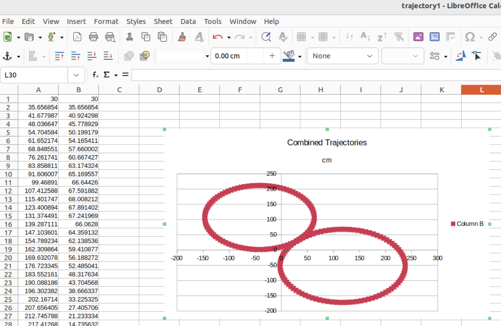

### Environment map (cpp/environment_map.cpp)

The map is just a text file of x y points. Each pillar and the charger is a circle of 18 points, the walls are a point every centimetre, and the robot is a 25 cm square in the corner at (0.3, 0.3). Plotting the two columns as a scatter chart gives the room layout, which is what the charger node is driving through.

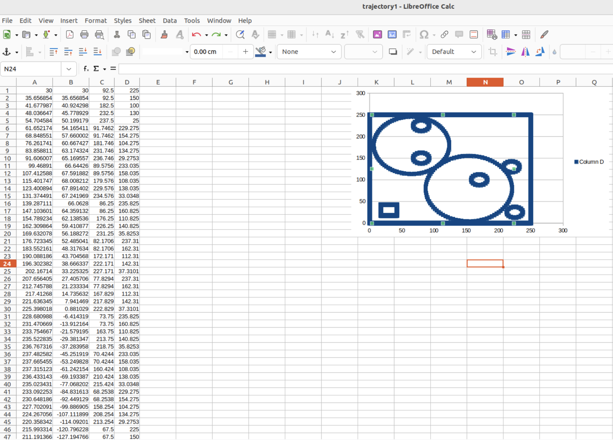

### Landmark based navigation to the charger (cpp/robot_stopper_node.cpp)

The node navigates by landmarks: each pillar and wall the robot passes has a known laser distance, and reaching that distance moves the robot to the next stage. It reads eight laser beams at 45 degree spacing, each found by angle from the scan's angle_min and angle_increment, subscribing with the ROS2 sensor data QoS profile so it matches the best effort scan topic. Stage 1 drives at 0.5 m/s until the front beam sees the first pillar at 1.3 m. Stage 2 curves right at 0.3 m/s until the front left beam opens past 1.43 m. Stage 3 drives until the front beam reads 0.6 m. Stage 4 curves right again until the front right beam drops under 0.32 m. Stage 5 creeps at 0.1 m/s until the front beam reads 0.43 m, and stage 6 stops at the charger.

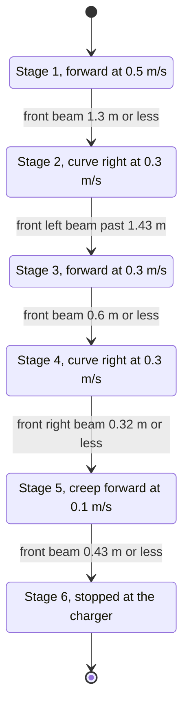

Two checks keep it safe. Readings that are NaN, infinite or out of range are ignored, and if the beam the current stage depends on has no usable reading, the robot stops and waits in that stage. If no scan arrives for one second, the robot also stops and waits until scans come back. The landmark distances came from trial runs and from reading the logged laser data. Adding the three rear beams at 135, 180 and 225 degrees made the map log noticeably more complete.

Every scan is written to laserData.csv, and each beam is converted into room coordinates using the robot's pose and written to laserMapData.csv, which plots as a map. The odometry callback logs the trajectory and the current speed so the whole run can be graphed.

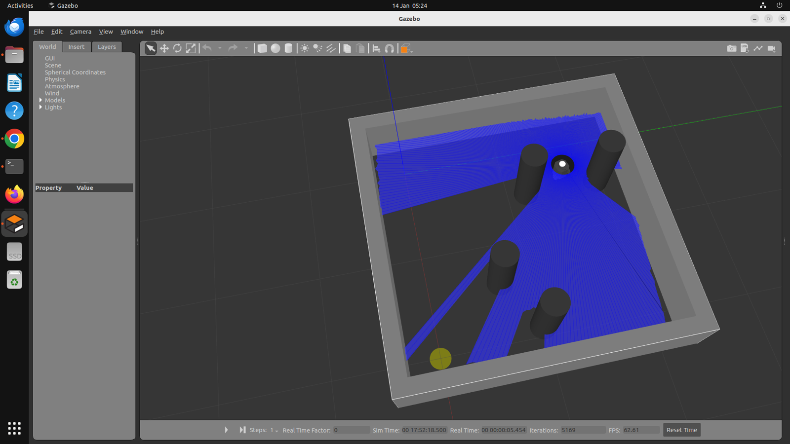

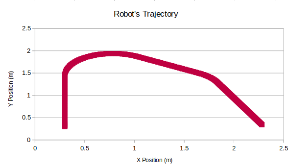

## Source code

The source code is private and available on request. Contact me at mkhodir77@gmail.com.

## What's in this repo

- `media/photos/` the TurtleBot in the arena.
- `media/figures/` the plots and screenshots of the runs.
- `media/demo/` the demo recordings, GIFs to watch here and one MP4 with captions.

## Demo

**The real TurtleBot.** The robot driving between the pillars in the arena. Real footage.

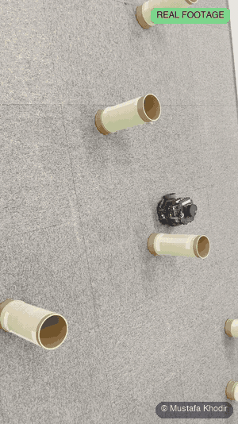

The simulations below use a 2D simulator with a laser model, not Gazebo. The ROS2 nodes run unchanged on a stand in for rclpy.

**Square path (simulation).** trajectory_tracking.py driving the 1 m square on wheel odometry alone.

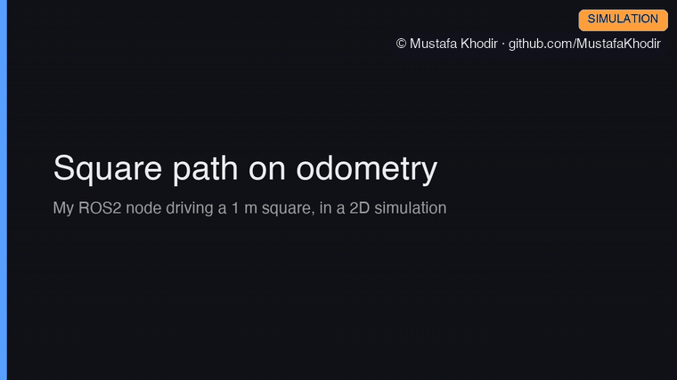

**My real odometry logs.** Test 1 and test 2 from the real TurtleBot, plotted point by point. This one is logged data, not a simulation.

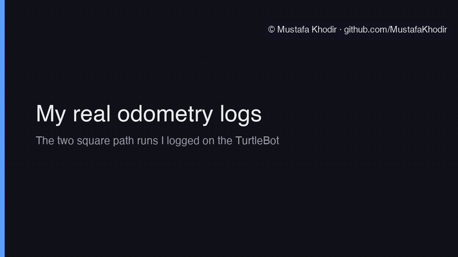

**Laser navigation (simulation).** laser_navigation.py driving for two minutes in a 2D copy of the TurtleBot3 world, with no collisions.

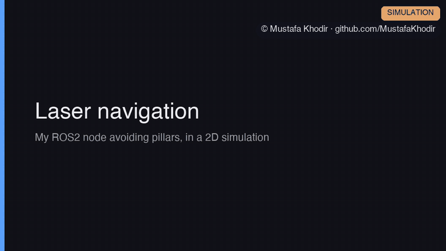

**Odometry simulation in C++.** The two robots from odometry_sim.cpp, drawn from the CSV it writes.

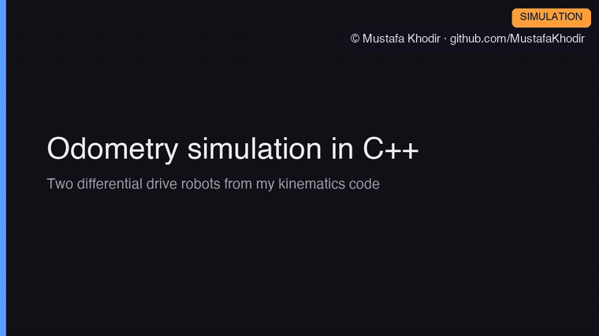

All four with captions:

https://github.com/user-attachments/assets/df618e0d-7ce8-4074-a843-5e4f4c39139e

The same video is in the repo as [ros2-mobile-robotics-demo.mp4](media/demo/ros2-mobile-robotics-demo.mp4) (92 s). Background music in the MP4 is a driving synthwave track, synthesised from scratch for these demos and released as CC0.

The full project report is available on request.

Copyright 2026 Mustafa Khodir. All rights reserved.
